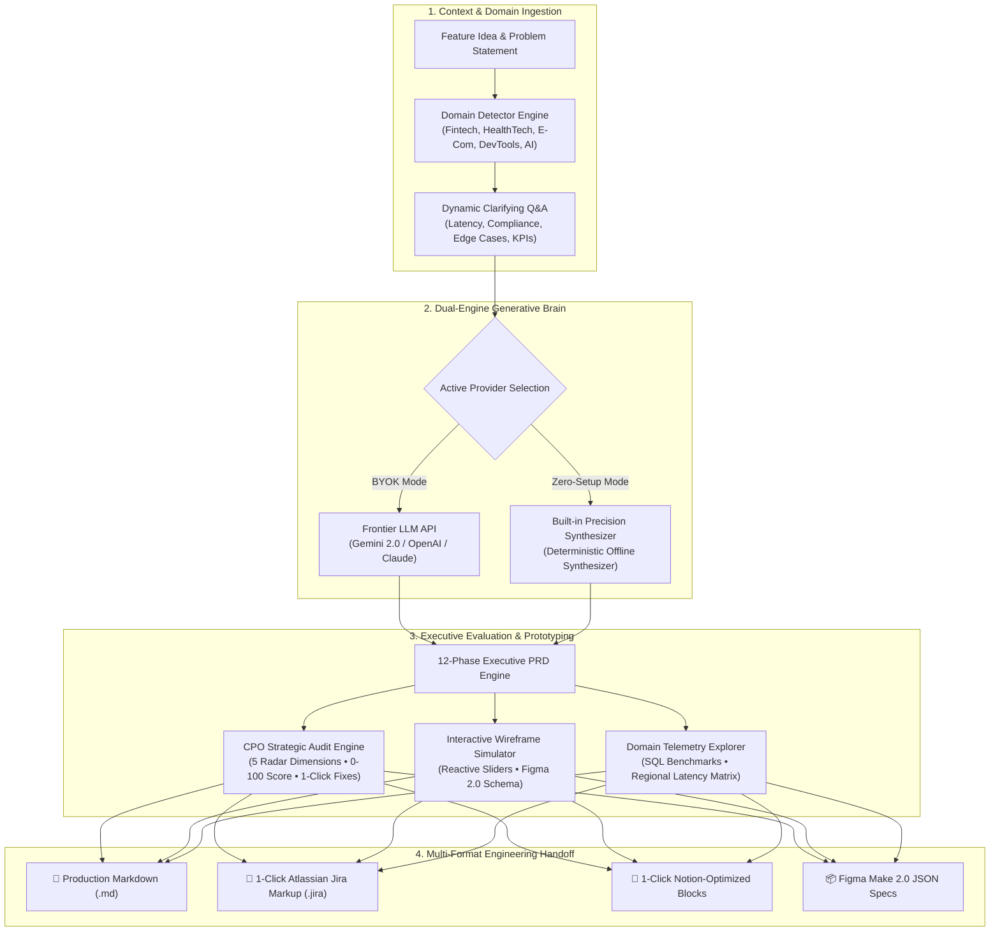

<div align="center">

# 🚀 THE PRD BOT
### The AI-Native Product Lifecycle Engine for Elite Product Managers

[](https://github.com/QuantamRam/THEPRDBOT/stargazers)
[](https://vitejs.dev/)
[](https://developer.mozilla.org/en-US/docs/Web/JavaScript)
[](https://deepmind.google/technologies/gemini/)
[](https://cursor.com)
[](LICENSE)

<br/>

**Transform raw feature ideas into production-grade, executive-approved 12-Phase PRDs backed by real SQL telemetry, Gherkin acceptance criteria, interactive visual prototypes, and 1-click Jira & Notion sync.**

[Explore Live Demo](http://localhost:5173) • [Report Bug](https://github.com/QuantamRam/THEPRDBOT/issues) • [Request Feature](https://github.com/QuantamRam/THEPRDBOT/issues)

</div>

---

## 💡 The Problem: Why 90% of AI PRD Tools Fail

Most AI PRD generators on the web are toy wrappers around standard ChatGPT prompts. They output generic marketing fluff, lack architectural contracts, invent imaginary metrics without schemas, and are completely unusable for real engineering sprints or CPO reviews.

**THE PRD BOT** was architected from the ground up to solve this:
1. **No Hallucinated Data:** Grounded in domain-specific SQL telemetry schemas (`payment_transactions`, `clinical_encounters`, `checkout_funnel_events`, `telemetry_traces`).
2. **Engineering-Ready Rigor:** Every P0 functional requirement includes formal **Gherkin (`GIVEN / WHEN / THEN`)** acceptance criteria.
3. **Fail-Safe Operational Architecture:** Includes negative edge-case matrices, fallback pipelines, and production Mermaid sequence diagrams.
4. **Handoff Friction Eliminated:** 1-Click native Atlassian Jira markup conversion and rich Notion blocks export.

---

## 🏗️ System Architecture & Execution Pipeline



---

## ⚡ Key Architectural Highlights

### 1. 🧠 Dual-Engine AI Architecture (BYOK + Offline Precision)
- **Bring-Your-Own-Key (BYOK):** Seamless client-side integration for **Google Gemini API** (`gemini-2.0-flash`, `gemini-1.5-pro`, `gemini-1.5-flash`), OpenAI, and custom OpenAI-compatible gateways. API keys are stored solely in browser `localStorage` and never touch an intermediary server.
- **Offline High-Precision Synthesizer:** When operating without external API keys or offline, an intelligent rule-based synthesis engine constructs domain-accurate SQL schemas, Gherkin specs, and sequence diagrams with 0 external dependencies.

### 2. 🏛️ The 12-Phase First-Principles PRD Framework
Every generated specification adheres strictly to top-tier enterprise standards (inspired by Amazon 6-Pager, Stripe RFC, Reforge, and Google PDLC):

```text
PHASE 1:  Executive Summary, Strategic Intent & North Star Objective
PHASE 2:  Problem Statement, First Principles & Customer Friction ("Why Now?")
PHASE 3:  Target Personas & Jobs-to-be-Done (JTBD Framework)
PHASE 4:  Strategic Alignment, In-Scope Goals & Explicit Out-of-Scope Non-Goals
PHASE 5:  Quantitative Evidence & Domain SQL Telemetry Benchmarks
PHASE 6:  Qualitative Evidence, CAB Quotes & 4-Column Competitor Matrix
PHASE 7:  Functional Requirements & Detailed Gherkin (Given/When/Then) Acceptance Criteria
PHASE 8:  Non-Functional Requirements (p50/p95/p99 Latency, SOC2/HIPAA/PCI Compliance)
PHASE 9:  Persona User Stories & Exhaustive Negative Edge-Case Matrix
PHASE 10: System Architecture, Mermaid Sequence Diagram & REST JSON API Contract
PHASE 11: Go-to-Market Phased Canary Rollout Rings & Rollback Triggers
PHASE 12: Success Metrics Tree (North Star, L1 Operational, Guardrails) & Review Cadence
```

### 3. 🧪 Multi-Model & Multi-Framework AI Playground
Benchmark different frontier models against industry-proven product frameworks:
- **Models:** Gemini 2.0 Flash, Gemini 1.5 Pro, GPT-4o, GPT-4o Mini, Claude 3.5 Sonnet, Llama 3.3 70B, and Built-In Synthesizer.
- **Framework Styles:**
  - 📦 **Amazon 6-Pager:** Customer Launch Press Release + Internal & Customer FAQ + Strategic Tenets.
  - 💳 **Stripe Technical Spec:** API-first RFC with `Idempotency-Key` headers, Redis lease locking, and RFC 7807 error schema.
  - 📈 **Reforge Growth PRD:** Acquisition & activation funnels, retention loops, and payback period metrics.
  - ⚡ **Lenny's 1-Page Lean PRD:** Hypothesis-driven, ship-in-2-weeks speed brief.
  - 🏛️ **Standard 12-Phase Executive PRD:** The complete, rigorous production specification.
- **Benchmarking Engine:** Live latency counter (ms), estimated token consumption meter, and 1-click output copy.

### 4. 🛡️ CPO Strategic Executive Audit Engine
Before presenting to leadership, an automated Chief Product Officer audit scans the PRD across 5 dimensions:
- *Strategic Alignment & Problem Framing*
- *Evidence & Telemetry Grounding*
- *Acceptance Criteria & Engineering Readiness*
- *Edge Case & Vulnerability Coverage*
- *KPI Actionability & Metrics Tree*
- **Actionable Amendments:** Identifies critical blind spots (missing rollback triggers, missing idempotency headers, unquantified latency budgets) with **1-Click Apply** buttons that inject amendments directly into the PRD and recalculate the audit score in real time.

### 5. 🎨 Interactive Visual Prototyping & Figma Schema
- Dynamic UI simulation card tailored to the active domain (e.g., fraud score threshold badges for Fintech, SOAP note electronic signature cards for HealthTech, express checkout drawers for E-Commerce, latency heatmap alerts for DevTools).
- Reactive threshold sliders that dynamically adjust simulated UI triage badge states between Green (Auto-Approved), Amber (Requires Review), and Red (Escalated).
- 1-Click export to **Figma Make 2.0 JSON** component tokens.

---

## 📊 Comparison Matrix

| Capability | THE PRD BOT | Generic ChatGPT Prompts | Static Notion Templates |
| :--- | :---: | :---: | :---: |
| **Domain-Tailored SQL Schemas** | ✅ Yes (Syntactically Valid) | ❌ Generic Text | ❌ None |
| **Gherkin Acceptance Criteria** | ✅ Yes (`Given/When/Then`) | ⚠️ Rare / Inconsistent | ❌ Manual Work |
| **Automated CPO Audit Scoring** | ✅ Yes (0-100 Score + Fixes) | ❌ None | ❌ None |
| **Interactive UI Simulation** | ✅ Yes (With Sliders) | ❌ None | ❌ None |
| **1-Click Jira Markup Sync** | ✅ Native Atlassian Format | ❌ Markdown only | ❌ Manual copy |
| **1-Click Notion Block Sync** | ✅ Yes (Callouts & Toggles) | ❌ Unformatted | ⚠️ Basic Paste |
| **Zero-Setup Offline Operation** | ✅ Yes (Built-In Engine) | ❌ Requires Internet/Key | ✅ Static Text |
| **Frontier Model Playground** | ✅ Gemini, Claude, GPT, Llama | ❌ Single Model | ❌ None |

---

## 🎨 Design Philosophy: Cursor Design System

THE PRD BOT adheres strictly to the **Cursor Design System (`cursor.design.md`)**:
- **Canvas:** Warm editorial cream (`#f7f7f4`), rejecting generic dark-IDE cliches for marketing clarity.
- **Typography:** Inter at weight 400 with negative tracking for an editorial feel, paired with **JetBrains Mono** on every code and telemetry surface.
- **Accent Voltage:** **Cursor Orange (`#f54e00`)** used scarcely for primary CTAs and wordmarks.
- **AI Action Stages:** Signature five-pastel palette scoping execution states:
  - 🍑 Peach (`#dfa88f`) — `THINKING`
  - 🌿 Mint (`#9fc9a2`) — `GREPPING`
  - 🌊 Blue (`#9fbbe0`) — `READING`
  - 🌸 Lavender (`#c0a8dd`) — `EDITING`
  - 🍯 Gold (`#c08532`) — `DONE`
- **Dark Mode Support:** Seamless toggle to Obsidian Dark (`#0d0e11`) with persisted local storage.

---

## 🚀 Quickstart & Installation

### Prerequisites
- [Node.js](https://nodejs.org/) (v18.0.0 or higher recommended)
- `npm` or `yarn`

### Setup in 30 Seconds

```bash
# 1. Clone the repository
git clone https://github.com/QuantamRam/THEPRDBOT.git

# 2. Navigate to project root
cd THEPRDBOT

# 3. Install dependencies
npm install

# 4. Start Vite development server
npm run dev
```

Visit **`http://localhost:5173`** in your browser.

### Building for Production

```bash
# Generate optimized production bundle
npm run build

# Preview production build locally
npm run preview
```

---

## 📂 Project Structure

```text
THEPRDBOT/
├── index.html                   # Core application entrypoint & modal markup
├── package.json                 # Dependency manifest (Vite, Marked, Confetti)
├── cursor.design.md             # Machine-readable Cursor Design System tokens
├── README.md                    # Comprehensive technical documentation
├── REVIEW_LOG.md                # 5-Pass website audit & iterative self-review log
│
└── src/
    ├── main.js                  # Master conductor, DOM event listeners & state sync
    ├── style.css                # Cursor design system styles, modals & animations
    │
    ├── engine/
    │   ├── aiService.js         # BYOK client for Gemini/OpenAI & offline fallback
    │   ├── domainDetector.js    # Semantic domain classifier (Fintech, Health, etc.)
    │   ├── qaGenerator.js       # Dynamic domain-specific clarifying Q&A generator
    │   ├── prdGenerator.js      # Universal 12-Phase First-Principles PRD synthesizer
    │   ├── cpoAuditEngine.js    # 5-dimension strategic auditor & 1-click recommendations
    │   ├── wireframeEngine.js   # Dynamic interactive UI simulator & Figma JSON exporter
    │   ├── telemetryEngine.js   # Domain SQL benchmarks & regional compliance matrix
    │   └── playgroundEngine.js  # Multi-model benchmarking bench (Amazon, Stripe, Reforge)
    │
    ├── data/
    │   └── templates.js         # 8 industry archetype specifications & blank canvas
    │
    └── utils/
        ├── exportUtils.js       # File download (.md, .json) & confetti triggers
        └── jiraNotionExporter.js# AST/Regex converter for Jira Markup & Notion Blocks
```

---

## 👤 Author & Engineering Leadership

Crafted with first-principles precision by **Ram Chandar Sanaboyina**.

- **GitHub:** [@QuantamRam](https://github.com/QuantamRam)
- **Repository:** [QuantamRam/THEPRDBOT](https://github.com/QuantamRam/THEPRDBOT)

---

## 📄 License

This project is licensed under the **MIT License** — feel free to use it, customize it, and share it across product and engineering teams.
